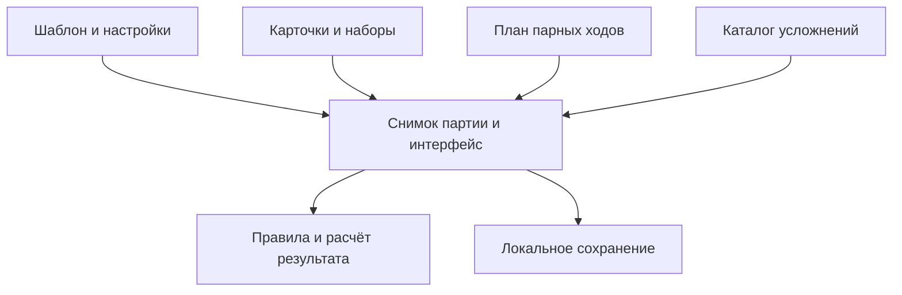

# QUIP — архитектурные контракты

Актуальное дополнение TASK 009 A: редакционный источник — `content/manifest.json` и перечисленные в нём JSON-файлы. `cards.js`, `approx-questions.js`, `content-packs.js` — детерминированные runtime-артефакты с прежним API. Старые описания этапов ниже фиксируют историю; новые данные добавлять по `CONTENT-WORKFLOW.md`, не редактируя сгенерированные файлы вручную.

## Этап 1: карточки

`cards.js` является авторитетным каталогом активных заданий (3016 исторических и последующие дополнения). Явный `id` закрепляется за карточкой навсегда и не должен меняться при редактуре текста, переносе между уровнями или наборами. Новый контент получает новый ID; старые ID не используются повторно. `type`: word/phrase/idiom/song/person; `difficulty`: easy/medium/hard; `categories`: набор тематических тегов; `pack`: core/music/people. `meta` используется для проверочных сведений (например, пример песни и артист), которые нельзя показывать отгадывающему.

Пустой массив `categories` означает, что тематическая классификация ещё не проведена. Не следует автоматически присваивать темы по одному слову. `getCardPool` возвращает структурированные записи, а `getPromptPool` временно преобразует их в строки для существующего игрового процесса. Исторические наборы `words.js`, `extra-words.js`, `curated-*.js` остаются в репозитории для аудита и последующей контролируемой миграции; они больше не являются авторитетным источником активного контента.

## Независимые подсистемы

Все перечисленные модули реализованы. Исторические версии правил и снимки партий не пересчитываются при обновлении.

1. **Ruleset:** rules.js, неизменяемая версия наград на партию; отдельно от формата сохранения version:1 и исторического scoringVersion.
2. **Modifiers:** modifiers.js, каталог с постоянными ID, тяжестью, применимостью и версией; сохранённый текст раунда остаётся авторитетным.
3. **Penalties and risk:** penalties.js, чистый расчёт успеха, начисления и ограниченного нулём штрафа.
4. **Round planner:** round-planner.js, одна сложность на пару, баланс по циклам и сохранение текущего плана.
5. **Content packs and presets:** content-packs.js и presets.js, точные версии фильтров и декларативные начальные настройки без копирования движка.

## Обязательная совместимость

Ключ `iskra-party:v1`, корневой `version:1`, поля `game.current.word`, `game.used` и старая история остаются в исходном строковом формате. Не преобразовывать сохранённые раунды в объекты без миграционного адаптера. Старые `scoringVersion!==2` сохраняют прежние правила. Новые изменения правил, штрафов, Микса и хранения требуют отдельных PR с тестами Node.js, Chromium, offline/PWA и загрузкой старых сохранений.

## Этап 2: версионированные награды и штрафы (реализовано)

`rules.js` хранит неизменяемые правила V1 (исторические матчи), V2 (старые дуэли) и V3 (очки по сложности). Новая партия фиксирует `rulesVersion:3`. Старая партия без `rulesVersion` продолжает действовать по `scoringVersion`. Значение `current.points` сохраняется в момент выбора задания и не пересчитывается после обновления или перезагрузки. Не переписывать старые версии реестра.

`penalties.js` содержит две чистые функции. `shouldSelectRisk(match,roll)` выбирает риск с вероятностью 20% после двух первых ходов, если он разрешён в настройках. `settleQuipRound(match,round,accepted,score)` вычисляет успех и изменение счёта, не изменяя сам матч. При провале риск-раунда теряется до 2 очков без перехода ниже нуля; при успешном выполнении штрафа нет. Старый V1 Блиц продолжает начислять очки по числу слов, V2 и V3 требуют все пять.

Усложнения, планировщик Микса и шаблоны внедрены следующими отдельными этапами TASK 003.

## Этап A: независимые усложнения (TASK 003)

`modifiers.js` — реестр V1 из 112 записей с явными постоянными ID, текстом, тяжестью, разрешёнными режимами и флагом enabled. `getModifierPool` фильтрует применимость; `chooseModifier` получает источник случайности и сохраняет шанс 35% для обычных режимов, обязательный выбор для Секретки. Базовый способ Секретки по-прежнему выбирает app.js из разрешённых методов.

Повторяющиеся тексты между степенями тяжести намеренно сохранены отдельными записями: например, «Показывай как робот.» раньше встречалось в easy и medium. Объединение изменило бы вероятность. Контрольные SHA-256 и размеры всех 18 исторических массивов закреплены в тесте, тексты и их веса не менялись.

Раунд хранит строку complication как авторитетный снимок, дополнительно complicationId и modifierVersion. При восстановлении каталог повторно не выбирается; отсутствие ID у исторического раунда допустимо. Версия усложнений не меняет rulesVersion:3, ключ/версию сохранения, награды, таймер и карточки.

## Этап B: парный «Микс» (TASK 003)

Новые партии фиксируют plannerVersion:1 и plannerState. round-planner.js не знает про DOM, карточки, очки и таймер. Чистая функция planRoundDifficulty возвращает сложность и новое состояние; Fisher–Yates выбирает порядок easy/medium/hard на цикл из трёх пар, каждая пара использует один уровень. Сохраняется лишь текущий цикл (постоянный размер состояния), следующий выбирается на его первом ходу. Фиксированные уровни не тратят случайность планировщика. Блиц продолжает брать короткие easy-слова и давать 3 очка.

app.js сохраняет план атомарно с текущим раундом в прежнем JSON-конверте. Ни рендер, ни восстановление не выбирают сложность заново. Перезагрузка во время карусели открывает уже выбранную карточку, а не возвращает ход к повторному выбору. Старые партии без plannerVersion сохраняют прежний независимый выбор. Порог очков проверяется после полной пары, ничья может продолжаться через сколько угодно циклов.

Неизвестные версии сохранения, подсчёта, правил или планировщика, некорректный сохранённый цикл блокируют запись в исходное сохранение; интерфейс сообщает о несовместимости. Данные не удаляются и не трактуются как новые. Новые версии правил для этого не вводились.

## Этап C: наборы и шаблоны (TASK 003)

content-packs.js описывает версии наборов (пара id/version), разрешённые типы, категории и критерии: явный список cardIds и исходные pack карточек. Категории внутри набора объединяются через OR, категории/ID/источник/тип/сложность пересекаются через AND. Пустые критерии означают отсутствие ограничения. defineContentPacks принимает декларации будущих пользовательских наборов без изменения движка. Регистрация не создаёт новые карточки и не меняет их ID.

checkContentPack проверяет каждый достижимый режим и уровень, включая все базовые методы Секретки, если она включена одна. Для Блица нужны минимум пять уникальных коротких easy-слов; генерация исключает уже выбранные слова текущего Блица даже при сбросе истории использования. Пустой или несовместимый набор не начинает партию, активная партия остаётся на месте. Общий general@1 даёт тот же словарь. Исторические версии тем @1 отключены до редакционной разметки; никакого неявного общего fallback нет.

presets.js задаёт classic-duel@1, hardcore@1 и отключённый thematic@1. Шаблон содержит настройки, а не награды, штрафы или копию движка. optionsForPartyPreset возвращает глубокую изменяемую копию декларации с provenance id/version, проверяя диапазоны и режимы. Новая партия копирует выбранные значения, contentPack id/version и provenance шаблона; при восстановлении шаблон повторно не применяется. Старые партии без этих полей используют прежний общий каталог. Точные версии наборов сохраняются в реестре неизменными; неизвестная версия блокирует перезапись данных.

Поток: шаблон → начальные настройки → снимок партии; планировщик → уровень; набор + карточки → допустимое задание; модификаторы → усложнение; rules + penalties → результат; app.js → интерфейс, таймер и сохранение снимка. Все новые JS включены в офлайн-кэш.

## Дополнения пользователя: первый ход и меню

chooseStartingTeam выбирает индекс 0/1 с равной вероятностью ровно один раз при создании партии. startingTeamIndex сохраняется в снимке; индекс текущего загадывающего = (roundIndex + startingTeamIndex) % 2. Подсчёт отгадывающему и проверка полной пары остаются прежними. Отсутствие поля у исторической партии означает прежний старт с игрока 1; восстановление не бросает жребий повторно.

В настройках подписи «Максимум очков» и «Минимальное время» заменяют старые формулировки. Диапазоны ползунков, дополнительное время режимов и обязательный ответный ход сохранены. Значение очков остаётся порогом завершения после полной пары, а не обрезанием заработанного счёта.

«Другие игры» — отдельный экран с шестью неинтерактивными заготовками, строго тремя симметричными колонками и квадратными местами для изображений. Открытие и возврат меняют только сцену; незавершённая партия не перезаписывается. Новые страницы других игр и внешние переходы не добавлялись.

Следующие приоритеты: редакционная разметка карточек для одной темы с проверкой достаточности всех уровней; затем доступный игроку выбор готовых наборов/шаблонов; реальные игровые отзывы о балансе. Массовая разметка и новые меню тем не входят в TASK 003.

## TASK 004 — этап A: параметры режимов и V4

mode-config.js — реестр V1 с базовыми очками, modifierBonus, usesTimer, allowsRisk, blitzWordsCount, supportsSharedAward, cardType, durationBonus, secretMethod и interaction. app.js читает список режимов и параметры из реестра; новая конфигурация получает новую версию. Снимок раунда хранит total points, basePoints, modifierPoints, usesTimer и blitzRequired; обновление/перезагрузка их не пересчитывает. Режим approx уже описан параметрами, но остаётся отключённым до отдельного этапа B.

Правила V4: Слова/Жесты/Нарисуй/Напой +1, Данетки/Секретка/Блиц +2; Примерно +1. Успех с усложнением даёт ещё +1. Секретка обязательна с усложнением, итог +3. Блиц V4 — три уникальных лёгких слова, награда только за 3/3; бонус усложнения также возможен. Неполный Блиц даёт 0, риск по-прежнему снимает до 2 при провале. История хранит итог и компоненты новой награды.

V1–V3 и их таблицы не изменялись. Исторические параметры отделены от V4: старый Блиц сохраняет пять слов и старое начисление, старый активный раунд хранит свою стоимость и таймер. Все прежние Node-сценарии теперь явно создают исторические V3-фикстуры через legacyGame(); дополнительные сценарии вызывают production newGame() и проверяют V4. Браузерные сценарии используют новые правила, а случайные усложнения отключаются лишь в геометрических/фиксированных подсчётных фикстурах; бонус отдельно проверен детерминированно.

Шаблоны v1 сохранены. Для новых настроек добавлены classic-duel@2 и hardcore@2. Корень сохранения version:1 и ключ iskra-party:v1 прежние. Новые версии JS и mode-config включены в precache.

### TASK 004 B: отдельное взаимодействие estimate

`ROUND_INTERACTIONS` связывает тип взаимодействия с task/judge, не меняя движок хода. `estimate` показывает вопрос в task и ответ с четырьмя вариантами в judge. Начисление использует чистый `settleSharedAward`; `completeRound` общий с explain, поэтому очередность, полный ответный ход и завершение партии сохраняются. Обработчики explain и таймера защищены от estimate.

Снимок `current.question` хранит ID, текст, ответ, единицы, примечание, категории и сложность. `answerRevealed` вместе с phase восстанавливает экран без нового выбора. История хранит `recipients`, `recipientNames`, `sharedAward`, `deltas` и answer. Исторический набор режимов при восстановлении без modes ограничен V1–V3. Для нового general@1 с включённым approx выбирается general@2; активный game не изменяется.

Каталог числовых вопросов независим от словесных карточек; `getPackQuestionPool` применяет те же категории/критерии без подмены общим набором. Тип number объявлен только в general@2. Новые версии пресетов не переписывают старые.

### TASK 004 C: выбор типа и темы

`game-type` и `themes` — входные сцены перед единственным `setup` и `advanced`. Выбор стандартной партии устанавливает general@2; выбор темы хранит точные id/version после проверки наполнения. Открытие/возврат меняют только сцену. Выбор набора меняет options, но не game; только успешный newGame заменяет активную партию. Значения длительности, сложности и provenance пресета сохраняются.

`listThematicPacks` читает реестр, исключает общий набор, выбирает последнюю зарегистрированную версию каждой темы и проверяет доступность для текущих режимов/уровней через checkContentPack. Шесть production-тем disabled/«Скоро». В тестах инъецируется отдельная наполненная декларация по трём стабильным ID, чтобы проверить полный путь и отсутствие fallback, не выдавая фикстуру за рабочий контент.

Обратные переходы: setup → выбор типа для стандартной / список тем для тематической; темы → выбор типа → меню. Перезагрузка восстанавливает options и game прежним механизмом; повторное применение пресетов и пересоздание текущего раунда отсутствуют. Все новые сцены остаются в index.html, общие ресурсы включены в PWA-кэш.
### TASK 005: оформление и компактные настройки

Два раздела advanced используют native details/summary; open сбрасывается только при входе в тонкую настройку и не записывается в сохранение. Checkbox, ограничения последнего режима/типа и существующие change-обработчики сохранены. Счётчики читают options, награды плиток — действующий V4 mode-config, изображения — MODE_ASSETS. Сетка режимов всегда 2 × 4.

В обычных настройках быстрые choices: очки 15/30/60/100, время 30/45/60. Они используют прежний обработчик choices и синхронизируются с ползунками в advanced. Произвольное значение из тонкой настройки отображается точно, без автоматического округления к быстрой кнопке. Пресеты и сохранённые значения не изменены.

«Примерно» меняет только представление: карточка ограничена доступной областью и растёт по содержимому. Ответ расположен сверху отдельным несжимаемым блоком; вопрос и пояснение прокручиваются внутри approx-copy. На низком широком экране четыре кнопки идут в один ряд, освобождая место для текста. Вопросы, награды, обработчики начисления и формат снимка не изменены.

### TASK 006: справочник правил

В app.js rulesGuidePage — только презентация новых партий V4, независимо от текущего game. Порядок девяти страниц фиксирован; описания обычных способов читаются из mode-config, Блиц собирается из актуального blitzWordsCount вместо исторического поля rule. Награды и риск — из текущего ruleset, бонусы/таймер/применимость — из mode-config; диапазон базового времени — из существующего input настроек. Справочник не вызывает persist, не пересчитывает раунды и не меняет исторические реестры.

Диалог сохраняет существующие способы закрытия. При открытии индекс сбрасывается, фокус переходит на закрытие, фоновая site-shell становится inert. При закрытии фокус возвращается инициатору. Tab удерживается внутри, стрелки/свайпы ограничены первой и последней страницей, Escape закрывает. Pointer-жест требует горизонтального преобладания и минимальной дистанции; вертикальная прокрутка и pointercancel отменяют переключение. Reduced motion отключает переход. Геометрия диалога постоянна, прокручивается только rules-copy; на низких экранах иллюстрация и текст стоят рядом.

### TASK 007 A: независимый получатель очков

awardPolicyVersion:1 и awardTo:setter/guesser фиксируются в новой партии отдельно от rulesVersion и scoringVersion. awardRecipientIndex — чистое разрешение получателя. currentTeamIndex/guessingTeamIndex и роли/подсветка не меняются; успех, риск, Блиц и история используют awardTeamIndex. «Примерно» остаётся независимым ручным начислением. Отсутствие политики означает прежнего получателя: scoringVersion:2 → отгадывающий, исторические партии → команда текущего хода. Неизвестная политика блокирует перезапись сохранения.

Обычный setup содержит один переключатель сразу после игроков. Новые чистые настройки: загадывающий, без Данеток; неизменяемые пресеты сохранены. Автоотключение Данеток работает только при переходе guesser → setter, включая безопасный fallback на Слова, если остался пустой список. Ручное включение не отменяют render, переходы, повторный выбор уже активной кнопки или восстановление. Сохранённый список режимов сохраняется при загрузке старых настроек; автоотключения во время рендера/миграции нет.

### TASK 007 B: отдельный исход усложнения, V5

V1–V4 сохранены неизменными. Новая V5 использует прежние базовые награды и Блиц 3/3, добавляя splitModifierOutcome. settleQuipRound принимает успех основного задания и усложнения, возвращает базу/фактический бонус, награду, штраф и outcome без мутаций. recordAnswer — единая точка получателя, счёта, истории и completeRound для быстрых действий и judge. Частичный исход отсутствует у старых правил и без усложнения; неполный Блиц не получает базу. Секретка с нарушением условия даёт 2, с выполнением 3; в обоих случаях без риска за провал. Исторические V4 с awardPolicyVersion:1 остаются V4 и сохраняют прежнюю полную стоимость успеха.

Снимок current.points/basePoints/modifierPoints остаётся авторитетным. История V5 добавляет taskSuccess/modifierSuccess, outcome, baseAwarded, фактические modifierPoints, reward, penalty и modeName; старые строки читаются без миграции. Кнопки используют общий resultControls и размер активного таймера. При усложнении скрытие слова остаётся рядом с таймером. Judge показывает имя отгадывающего и отдельно получателя награды, фиксирует кнопки снизу, длинный текст прокручивает внутри. На низком широком экране timed task/countdown/play используют общую двухколоночную геометрию.

### TASK 007 C: независимая политика выбора усложнений

Каталог 112 записей и историческая chooseModifier не изменены. modifierSelectionVersion:1 фиксируется при newGame отдельно от rulesVersion/очков, вместе с modifierChance и modifierRecent (последние пять пар id/key). Единая декларация политики задаёт defaultChance 20, диапазон 10–100, шаг 5 и recentLimit 5. Настройка options сохраняет процент при выключении галочки; снимок партии не зависит от будущих настроек.

choosePartyModifier — чистый выбор с внедряемым RNG: сначала применимость режима и необязательный шанс, затем пул текущего метода/сложности, исключение недавних ID и нормализованного текста (NFKC, регистр, ё/е, пробелы/пунктуация). При пустом пуле кандидатов снимается самое давнее ограничение; число проходов ограничено recentLimit + 1. Секретка обходит checkbox/шанс, но использует тот же список исключений; Примерно не участвует. app.js записывает возвращённый recent только при выборе раунда. Восстановление и render не выбирают усложнение заново.

Отсутствующая политика означает прежний chooseModifier с 35% и без защиты от повторов, в том числе для V5 этапа B. Неподдерживаемая/неполная политика блокирует перезапись исходного сохранения. Корень version:1 и ключ iskra-party:v1 прежние. Браузерный тест обновления worker устанавливает реальные HTML/CSS/JS и worker этапа B из неизменяемого коммита b532dbc, создаёт в них V5-партию, затем возвращает ресурсы C. Установка worker загружает CORE с cache:reload, чтобы старый свежий HTTP-кэш не вернул предыдущий HTML/JS в новый офлайн-кэш. Новая активация удаляет старый кэш, сохраняет партию и позволяет завершить её офлайн. При shallow checkout тест загружает только этот фиксированный коммит без переключения ветки.

### TASK 008 A: расширение авторитетного каталога

Новые записи добавляются только в cards.js и approx-questions.js с постоянными ID. Диапазон A: карточки 008001–008100 в пределах каждого типа, вопросы approx-8001–8030; исходные записи побайтно эквивалентны по сериализованным объектам. Скрипт scripts/catalog-audit.cjs не модифицирует данные и выдаёт распределения, дубли, кандидатов по типу/длине и число слов Блица. Новые факты содержат URL первоисточника или расчётную формулу. Поле pack числовых вопросов уже существовало; компактная запись теперь допускает явный источник набора с прежним значением по умолчанию для старых вопросов. Никаких миграций партий.

### TASK 008 B: доступность тематических способов

Новые версии наборов могут объявлять allowedModes и secretMethods; эти массивы проверяются и замораживаются. Старые декларации не дополнены неявными ограничениями. geography@2 выбирает только source pack geography-v2 с категорией geography. checkContentPack и rollOutcome используют один secretMethodsForPack; без нового поля прежние пять способов и порядок выбора сохраняются. Проверка охватывает каждый достижимый уровень/метод, включая одиночную Секретку и короткий easy-пул Блица. Неподдерживаемые режимы не стартуют.

packSetupSettings — чистая подготовка допустимых режимов/типов для явного входа в тему. Меню доступности использует её для новых объявленных наборов, поэтому выбранное в стандартной игре пение не скрывает готовую Географию. В options добавлен необязательный packPreferences с режимами/типами по id@version; текущий профиль запоминается только при явном переключении набора, а при повторном выборе текущего берутся актуальные options. Эти будущие настройки не попадают в game и не мигрируют исторические партии. Снимок game уже содержит точную версию набора, modes и promptTypes.

Тонкая настройка использует прежние checkbox: input.disabled и видимая причина для отсутствующего пула. Геометрия игры, награды, правила V1–V5, риск, Микс и алгоритм усложнений не менялись. scripts/game-simulation.cjs создаёт только тестовую оболочку DOM и загружает настоящие runtime-скрипты из index.html; он не переопределяет игровые правила.

### TASK 008 C: научный контент и диагностика

science@2 использует тот же контракт allowedModes/secretMethods, что geography@2, с категорией science и source pack science-v2. Обе темы изолированы; версии @1 сохранены. Данные добавлены в cards.js и approx-questions.js, без второго каталога.

`scripts/balance-audit.cjs` загружает production-скрипты через тестовую DOM-оболочку game-simulation.cjs. Фиксированные seed воспроизводят выбор режимов, Микс, частоты усложнений, исчерпание пулов и ограничения повторов. Скрипт не участвует в runtime и не изменяет правила, награды, таймеры или вероятности. Отчёт и JSON содержат ограничения конечных пулов и отдельной истории Блица.

### TASK 009 A: источники и защита сохранения

Редактируемые источники разделены на исторические типы и независимые дополнения TASK 008. Manifest определяет явный порядок, открытую таксономию категорий и источники деклараций наборов. Добавление категории не регистрирует игру и не меняет app.js. Baseline-lock фиксирует все прежние объекты; генерация сохраняет их порядок и значения. Шаблоны содержат только прежние runtime-функции. В браузере остаются те же три файла, новых запросов и загрузчика нет.

Единый build-time content.cjs проверяет схемы, ID, нормализованные дубли, исторические исключения, категории, числовые ответы/формулы/синтаксис источников и достижимые пулы; audit дополнительно выдаёт близкие тексты на ручную проверку. Он не доказывает фактологию URL или смысловую принадлежность. Старые версии наборов неизменны; будущие расширенные пулы получают новые декларации и source packs.

readSaved отличает отсутствие ключа от повреждённого JSON/корня, ошибки чтения и несовместимой версии. Повреждение блокирует persist до явного согласия на восстановление. Копия исходной строки атомарно записывается и проверяется в ограниченной отдельной записи до изменения основного ключа; изменение исходника во время подтверждения останавливает сброс. Неизвестные версии не восстанавливаются сбросом. Корень version:1 и основной ключ прежние; восстановление уже выбранного раунда не запускает выбор заново.

## TASK009 B: история выдачи

`task-history.js` содержит чистую версионированную политику выбора и ограниченного локального архива. Новые игры получают `taskHistoryVersion: 1`; старые снимки сохраняют прежний путь выбора. Дополнительный `taskMemory` не меняет корневой ключ или версию сохранения. Контракт приоритетов, границы памяти и исчерпание: [TASK-HISTORY.md](TASK-HISTORY.md).

## TASK009 C: усложнения V2

Новые партии фиксируют `modifierCatalogVersion: 2` и `modifierSelectionVersion: 2` независимо от `rulesVersion: 5`. Чистые пулы и выбор — `modifiers-v2.js`, редакционные данные — `content/modifiers/`, воспроизводимая сборка — `scripts/modifiers-v2.cjs`. Все 112 записей V1 и обе исторические политики сохранены. Точные уровни, применимость, семейства, безопасные альтернативы и открытое предложение по Данеткам описаны в [MODIFIERS-V2-AUDIT.md](MODIFIERS-V2-AUDIT.md); полный перечень — [MODIFIERS-V2-CATALOG.md](MODIFIERS-V2-CATALOG.md).

## TASK009 D1: фиксированные версии общего каталога

Новый source pack `general-expansion-v1` включён в общий набор @3 с явным списком источников. Адаптер `historicalGeneralRecord` сохраняет прежнюю вселенную общего @1/@2, не редактируя их декларации. Новые источники не могут повторно использовать исторический origin: это проверяет общий валидатор. `latestGeneralPackSelection` применяется только при начале новой общей партии и выборе стандартной игры. Старые партии и тематические @2 остаются на своих наборах. Подробности и распределение: [DICTIONARY-AUDIT.md](DICTIONARY-AUDIT.md).
